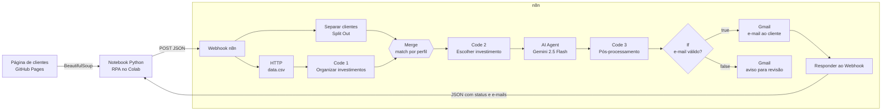

# Assistente de Investimentos com RPA + n8n + IA Generativa

Projeto desenvolvido para o desafio **"Criando um Assistente de Investimentos com RPA e IA Generativa"** da [DIO](https://www.dio.me/).

O pipeline coleta dados de clientes em uma página web (RPA com Python), envia esses dados para um workflow no **n8n**, cruza o perfil de cada cliente com uma base de investimentos e gera **e-mails de recomendação personalizados com IA (Google Gemini)**. E-mails inválidos são separados automaticamente para revisão manual.

---

## ✅ Entregáveis

| Item | Status | Onde |
|---|---|---|
| Repositório forkado com o workflow implementado | ✅ | este repositório |
| Workflow exportado com mensagens estáticas (MVP) | ✅ | [`n8n/workflow_mvp_mensagens_estaticas.json`](n8n/workflow_mvp_mensagens_estaticas.json) |
| Workflow completo com Agente de IA | ✅ | [`n8n/workflow.json`](n8n/workflow.json) |
| Script de RPA integrado ao Webhook do n8n | ✅ | [`rpa/extrair_clientes.ipynb`](rpa/extrair_clientes.ipynb) |
| Mensagens geradas dinamicamente via LLM | ✅ | nó *AI Agent - Email com IA* (Gemini 2.5 Flash) |
| Demonstração de ponta a ponta | ✅ | saídas salvas no [notebook](rpa/extrair_clientes.ipynb) e prints em [`docs/prints/`](docs/prints/) |
| Documentação das decisões técnicas | ✅ | este README |

---

## 🏗️ Arquitetura



### Etapas do workflow

| # | Nó | O que faz |
|---|---|---|
| 1 | **Webhook** (`POST /clientes`) | Recebe `{"clientes": [...]}` enviado pelo notebook. |
| 2 | **Separar clientes** (Split Out) | Transforma a lista em um item por cliente. |
| 3 | **HTTP - Buscar investimentos** | Baixa o `docs/data.csv` como texto. |
| 4 | **Code 1 - Organizar investimentos** | Converte o CSV em tabela: `perfil`, `produto`, `minimo` (número), `minimo_formatado` (R$) e `rentabilidade`. |
| 5 | **Merge - Clientes + Investimentos** | Junta as duas fontes em uma mesma tabela por *matching field* `perfil` (cada cliente × produtos do seu perfil). |
| 6 | **Code 2 - Mensagens personalizadas** | Escolhe, para cada cliente, o investimento do perfil com a maior aplicação mínima que o saldo comporta. Também gera a mensagem estática (MVP), usada como *fallback*. |
| 7 | **AI Agent - Email com IA** + **Gemini** + **Structured Output Parser** | Faz o *briefing* do cliente e escreve o e-mail, devolvendo `assunto` e `corpo` em JSON. |
| 8 | **Code 3 - Pós-processamento do email** | Garante os campos `emailTo`, `subject`, `textBody`, `htmlBody` e `emailValido`, limpa markdown e aplica *fallback* se a IA falhar. |
| 9 | **If - E-mail válido?** | Regex de validação do `emailTo`. |
| 10a | **Enviar e-mail ao cliente** (Gmail) | Ramo *true*: envia a recomendação. |
| 10b | **Avisar e-mail inválido (para mim)** (Gmail) | Ramo *false*: envia ao responsável os dados do cliente para tratamento manual. |
| 11 | **Responder ao Webhook** | Devolve ao notebook `status`, `total_clientes`, `enviados`, `para_revisao` e os e-mails gerados. |

---

## 🧠 Decisões técnicas

**1. RPA com `requests` + BeautifulSoup.**
A página de clientes não tem API, então o notebook lê a tabela `#clientes` como um usuário faria e envia o resultado ao n8n em um único `POST`. Assim o script fica simples e todo o processamento acontece no workflow.

**2. CSV lido direto do repositório.**
O `data.csv` é buscado pelo link *raw* do GitHub. Isso funciona mesmo sem ativar o GitHub Pages no fork, e qualquer alteração no CSV entra no fluxo sem precisar mexer no n8n.

**3. Code 1 para "organizar" os investimentos.**
O CSV chega como texto. O Code 1 transforma esse texto em itens tipados (o `minimo` vira número) e já formata os valores em reais, o que facilita as comparações no Code 2 e deixa a mensagem mais legível.

**4. Merge por `perfil` em vez de lookup dentro do código.**
O cruzamento cliente × investimento fica visível no canvas e pode ser inspecionado no próprio nó Merge. O modo *Keep Matches* com *Include All Matches* gera todas as combinações do perfil, e a regra de escolha fica isolada no Code 2.

**5. Regra de recomendação determinística (Code 2).**
A escolha do produto não fica com a IA. A regra é escolher o investimento do perfil com a **maior aplicação mínima que cabe no saldo**; se nenhum couber, o de menor mínimo, com a sinalização `saldo_suficiente = false`. Isso evita recomendações inconsistentes e garante que a IA só "redija" a partir de dados corretos.

**6. IA só para a redação, com saída estruturada.**
O AI Agent recebe o contexto pronto (nome, perfil, saldo, produto, taxa, mínimo e outras opções) e um *system prompt* com regras: português do Brasil, tom cordial, assunto de até 70 caracteres, uso apenas dos números informados e nenhuma promessa de rentabilidade. O **Structured Output Parser** obriga a resposta a vir como `{ assunto, corpo }`. O modelo é o **Gemini 2.5 Flash** (rápido e barato), com *retry* automático de até 3 tentativas.

**7. Pós-processamento obrigatório (Code 3).**
A saída de um LLM nunca é 100% garantida. O Code 3 padroniza os campos de envio (`emailTo`, `subject`, `textBody`, `htmlBody`), remove markdown, limita o tamanho do assunto, garante a assinatura e, se a IA falhar, usa a mensagem estática do MVP. O campo `geradoPorIA` indica qual caminho foi usado.

**8. Separação de e-mails inválidos (If).**
Clientes com e-mail inválido não recebem envio automático. O responsável recebe um aviso com todos os dados para tratar depois, e a lista também volta ao notebook em `para_revisao`.

**9. Resposta síncrona ao notebook.**
O Webhook usa *Respond to Webhook*. Assim, ao final da execução o Colab recebe a confirmação (`status: finalizado`) e os e-mails gerados, o que fecha o ciclo de ponta a ponta.

**10. Segurança.**
O notebook usa a *Test URL* do Webhook, que só aceita chamadas enquanto o editor do n8n está em modo de escuta. A *Production URL* não é publicada: como o fluxo envia e-mails por uma conta Gmail, deixá-la pública permitiria disparos por terceiros. O e-mail de revisão no `workflow.json` exportado é um *placeholder* (`SEU_EMAIL@gmail.com`).

---

## ▶️ Como executar

1. **n8n**: importe o [`n8n/workflow.json`](n8n/workflow.json) (menu **⋯ → Import from File**).
   - Configure a credencial do **Google Gemini** (no n8n Cloud é possível usar os créditos de *gateway*, ou crie uma chave no [Google AI Studio](https://aistudio.google.com/)).
   - Configure a credencial do **Gmail** nos dois nós de envio e troque `SEU_EMAIL@gmail.com` pelo e-mail que vai receber os avisos de revisão.
   - Os e-mails da página de exemplo são fictícios. Para testar o envio, use o seu próprio endereço ou desative o nó *Enviar e-mail ao cliente*.
2. **Webhook**: copie a *Test URL* do nó Webhook e clique em **Execute workflow**, ou publique o workflow e use a *Production URL*.
3. **Colab**: abra o [`rpa/extrair_clientes.ipynb`](rpa/extrair_clientes.ipynb), cole a URL em `WEBHOOK_URL` e execute todas as células.
4. O notebook imprime o status e os e-mails gerados para cada cliente.

Para a versão MVP (sem IA), importe o [`n8n/workflow_mvp_mensagens_estaticas.json`](n8n/workflow_mvp_mensagens_estaticas.json). Ele usa templates fixos por perfil:

- **Conservador**: foco em renda fixa e segurança.
- **Moderado**: equilíbrio entre renda fixa e variável.
- **Arrojado**: ênfase em renda variável e maior potencial de retorno.

---

## 📸 Demonstração

A execução completa está registrada nas **saídas do notebook** [`rpa/extrair_clientes.ipynb`](rpa/extrair_clientes.ipynb): os 10 clientes extraídos da página, o status `finalizado` devolvido pelo n8n e os e-mails gerados pela IA para cada cliente (`IA: True`).

Prints da execução em [`docs/prints/`](docs/prints/):

- Workflow completo no n8n executado com sucesso.
- Saída do Merge (clientes × investimentos).
- E-mails gerados pelo AI Agent.
- Resultado impresso no Google Colab.

---

## 📁 Estrutura do repositório

```
📁 dio-lab-assistente-investimentos-rpa-n8n/
├── 📄 README.md                                 # documentação do projeto
├── 📁 rpa/
│   └── 📄 extrair_clientes.ipynb                # RPA (BeautifulSoup) + envio ao Webhook do n8n
├── 📁 n8n/
│   ├── 📄 workflow.json                         # workflow completo (Merge + IA + validação de e-mail)
│   └── 📄 workflow_mvp_mensagens_estaticas.json # MVP com mensagens estáticas
└── 📁 docs/
    ├── 📄 index.html                            # página de clientes
    ├── 📄 data.csv                              # opções de investimento
    └── 📁 prints/                               # prints da execução
```

---

## 🛠️ Tecnologias

Python · Requests · BeautifulSoup · Google Colab · n8n Cloud · Google Gemini 2.5 Flash · Gmail · GitHub Pages

---

Desenvolvido por [@GhilhermeAlves](https://github.com/GhilhermeAlves) como parte do desafio da DIO.
